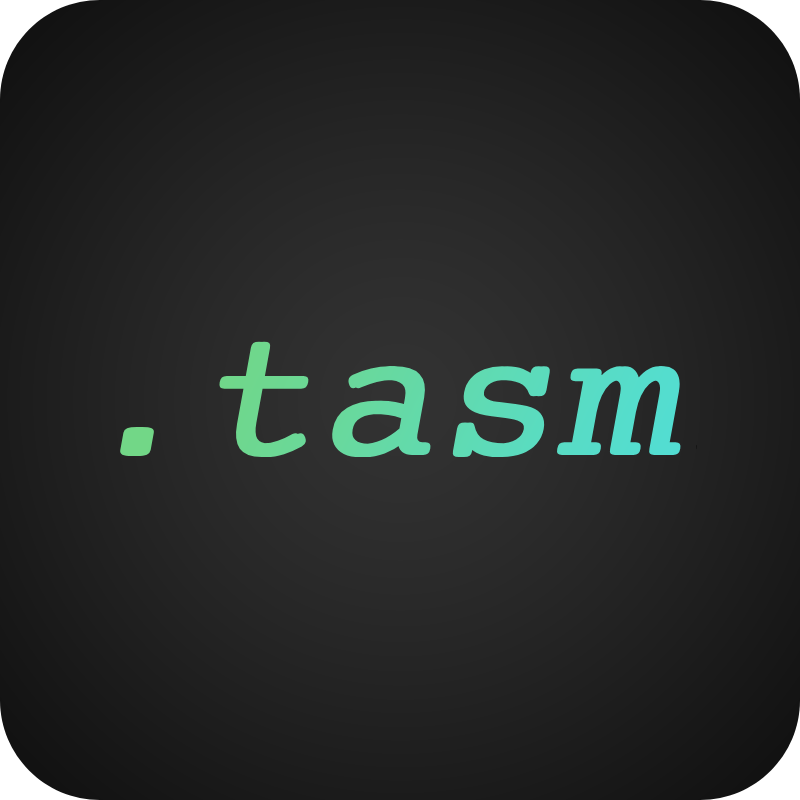

# .tasm 


A computational language that compiles to Geometry Dash trigger objects. Allows you to write complex trigger programs without actually placing triggers.
Not to be confused with the [Borland Turbo Assembler](https://en.wikipedia.org/wiki/Turbo_Assembler).  
  
TASM is currently in **version v0.3.2**.  
The working compiler is in the `rtasm/` directory.

Documentation can be found [here](https://tasm.mntpoint.org/docs/).  
Join the TASM community on Discord [here](https://discord.gg/spqKPeFvYf).
This language has [VS Code support](https://marketplace.visualstudio.com/items?itemName=ArrowSlashArrow.tasm-lang-gd).

# Overview
TASM (Trigger Assembly) is a language with assembly-like syntax made specifically for working with the trigger system in Geometry Dash. The language's instruction set features many instructions that, when combined, allow for the creation of [complex programs](example_programs). 

> [!NOTE]
> Currently, the language is geared more towards traditional programming, which means that the instruction set is currently made mostly of arithmetic, control flow, and memory. There are plans to expand it in the future to a broader instruction set which covers more of the triggers available in the level editor.

Features:
* Turing-complete instruction set
* Optimised trigger placement and group usage
* Extensive documentation
* Quick compilation to trigger objects
* Integration with dedicated backend: [GDlib](https://crates.io/crates/gdlib)
* Fast and versatile compiler
* Accessible standard library with plenty of needed algorithms

# Quick Start and Tutorial
## Quick Install
The TASM compiler (tasmc) now has an installer script for windows [here](https://tasm.mntpoint.org/install.ps1) and for linux [here](https://tasm.mntpoint.org/linux.sh). This is a powershell script that must be ran from the command line.
## SDK Usage Instructions
To use the current up-to-date SDK, you may do the following:
1. Refer to the releases in this repo for pre-built executables
    ```bash
    # In the extracted folder with the compiler,
    .\tasmc <your_file>
    ```
2. Clone this repository and run from source.
    ```bash
    git clone https://github.com/ArrowSlashArrow/tasm-lang
    cd tasm-lang/rtasm
    cargo build --release
    .\target\release\tasmc <your_file>
    ``` 

Note that running from source requires Rust v1.88.0. 

## Which executable should I use?
For windows:
- Use MSVC if you are unsure.
- Use GNU if you are not able to use MSVC or if your machine does not use MSVC in favor of something like MinGW.

For linux:
- there are two executables: one for musl (statically linked) and one for GNU (linked against `glibc`). Use whichever you prefer. 

## Useful compiler flags
Below is a list of commonly used compiler flags. This is not the full list of compiler flags, which can be accessed by running `tasmc --help`.
- `--gmd` / `-g`: Export to .gmd instead of writing directly to the savefile.
- `--release` / `-r`: Compile program with release mode optimizations enabled.
- `--level-name`: Sets the name of the exported level. Defaults to the name of the file.

## Tutorial
To get started with learning this language, head over to the [TASM book](). If this site is not available, refer to the same materials [here](docs/book/index.md).

## Compiling a program
The steps below assume that the compiler is in your `PATH`. 

### 1. Compiling to a .gmd file
Run `tasmc <file> --gmd`. 

### 2. Compiling to the savefile
Run `tasmc <file>`. This is the default mode for tasmc. 

> [!WARNING]
> Be careful when writing directly to the savefile! While GDLib is pretty good at it, it is ot 100% guaranteed to write correctly! Also, GD must be closed for 

> [!NOTE]
> If you are using tasmc on linux, the file will be called `tasmc` instead of `tasmc.exe`.
  
# Project Information
* TASM is not a mod. This project is intended to assist with creating trigger logic for GD levels. 
* The working compiler is located in the `rtasm` directory.
* There will not be an official higher-level language that compiles to TASM. That is not to say that creating such a language is discouraged though. If you like to, you are welcome to have a crack at it.
* Some valid TASM programs are in `example_programs`, `stdlib`, and `programs`. All of these programs are examples of valid TASM syntax. The `tests` directory is a collection of files used to test the compiler, however some are intentionally invalid. Files in `tests/` should not be taken as examples of good TASM code. 
* Old/deprecated files (such as the old pytasm compiler) are located in the `old` directory. Files there are considered deprecated and are not maintained. They should not be used to compile modern TASM.  
* Anyone is welcome to ask any questions on the [discord server](https://discord.gg/spqKPeFvYf). Any and all contributions are appreciated!